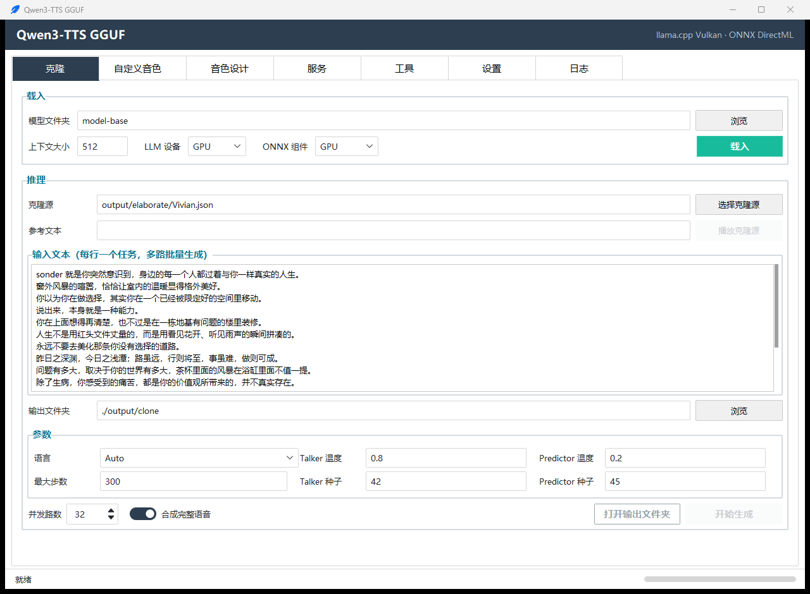
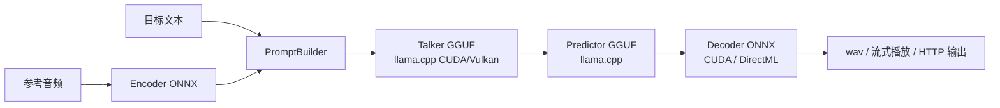
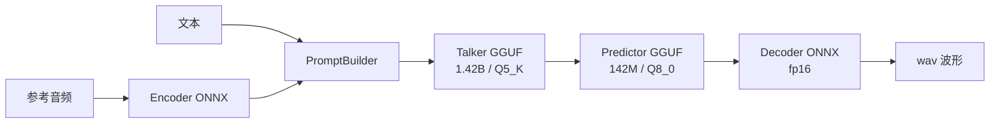

# Qwen3-TTS GGUF PLUS

[English](readme.en.md)

用 llama.cpp 跑的 Qwen3-TTS，支持流式合成、声音克隆，附带图形界面和 OpenAI 兼容的本地 HTTP 服务。

本项目基于 [HaujetZhao/Qwen3-TTS-GGUF](https://github.com/HaujetZhao/Qwen3-TTS-GGUF)（MIT）二次开发，在上游基础上修改并完善图形界面，并新增 OpenAI 兼容 HTTP 服务、一键安装脚本与模型导出脚本。

三步用起来：双击 `setup.bat` 装环境 → 准备 `model-base` 模型目录 → 双击 `启动GUI.bat`。



**效果试听**（点击下载后播放）：

| 示例 | 时长 | 说明 |
| :--- | ---: | :--- |
| [中文音色克隆](docs/demo/zh_clone.mp3) | 8.9 s | 用克隆音色朗读中文 |
| [英文跨语种克隆](docs/demo/en_clone.mp3) | 7.6 s | 同一音色克隆英文（跨语种） |

适合：想在 Windows 本机跑中文 TTS、给 SillyTavern / Cherry Studio 这类客户端一个本地 OpenAI 语音接口、8G 显存的笔记本。不适合：要云端级并发吞吐，或需要 Linux 原生 GUI 的场景。

## 目录

- [这个版本多了什么](#这个版本多了什么)
- [环境要求](#环境要求)
- [快速开始](#快速开始)
- [项目结构](#项目结构)
- [模型](#模型)
- [推理](#推理)
- [HTTP API 服务](#http-api-服务)
- [代码调用](#代码调用)
- [性能与显存](#性能与显存)
- [导出模型](#导出模型)
- [原理](#原理)
- [常见问题](#常见问题)
- [已知限制（欢迎 PR）](#已知限制欢迎-pr)
- [路线图](#路线图)

## 这个版本多了什么

相对上游的改动：

- **GUI 改造**（`qwen3_tts_gguf/gui`）：上游 GUI 本来就有克隆 / 自定义音色 / 音色设计 / 工具 / 设置 / 日志六个页，这里重做了视觉（顶部标题条、配色、中文字体、页面可滚动），并新增「服务」页——OpenAI 服务的启停、端口、状态都能在界面里点。
- **OpenAI 兼容 HTTP 服务**（`tts_server.py`）：`/v1/audio/speech`、`/v1/voices`，SillyTavern、Cherry Studio、Open WebUI 直接填地址就能用。
- **ONNX 也走 GPU**：N 卡可选 CUDA（`onnxruntime-gpu` + pip 安装的 CUDA 12 运行库，**不需要安装 CUDA Toolkit**），其它显卡走 DirectML；两个编码器也从固定 CPU 改为可上 GPU。
- **CUDA 运行库自检**：修复了「装了 CUDA 版 llama.cpp 但缺 cudart/cublas，backend 静默退回 CPU」的问题；`install.py` 按后端 major 版本校验并自动补装。
- **一键安装体检**（`install.py` + `setup.bat`）：Python 版本、虚拟环境、依赖、llama.cpp 运行库、模型、FFmpeg、音色目录逐项检查，缺什么装什么。
- **一键导出模型**（`export_model.py` + `export-model.bat`）：自动找源模型、按顺序跑完十四个导出脚本、校验产物。
- **中文文档与启动脚本**：`启动GUI.bat` / `启动服务.bat` / `克隆音色.bat`，双击即用。

上游本身提供的能力（推理内核未重写，以下均为上游实现）：

- **流式合成**：边推边播，首音延迟最低 300ms 内。
- **加速推理**：Talker / Predictor 走 llama.cpp（Vulkan 或 CUDA），Encoder / Decoder 走 ONNX Runtime（DirectML 或 CUDA）。
- **确定性控制**：Talker 与 Predictor 的随机种子可独立设置，输出可复现。

### 改动规模（相对上游 `74feb58`，v0.1.0 时统计）

| 项目 | 数值 |
| :--- | ---: |
| 新增文件 | **19 个**（约 2600 行） |
| 内容真实修改 | **48 个**文件 |
| 删除文件 | 11 个（上游入库的音色样例，属隐私清理） |
| 文本改动 | **+1582 / -694 行**（另 23 个文件仅换行差异） |
| README | 311 行 → 590+ 行（英文版同步） |

新增代码集中在四块：**安装体检 / HTTP 服务 / 一键导出 / 命令行工具**。`llama.py`、`talker.py`、`predictor.py`、`batch.py`、`prompt_builder.py`、`config.py` 与上游**逐字节一致**；`decoder.py` / `stream.py` / `voice.py` / `result.py` 只清理了日志文案与 emoji，推理逻辑未改。

## 环境要求

| 项目 | 要求 |
| :--- | :--- |
| 系统 | Windows 10/11 x64（Linux 需自行准备 llama.cpp 与 FFmpeg） |
| Python | **3.14**（`pyproject.toml` 要求 `>=3.14`） |
| 显卡 | 建议独显。N 卡走 CUDA 或 Vulkan；A 卡 / I 卡走 Vulkan；纯 CPU 也能跑，但 RTF > 1 |
| 显存 | 1.7B 全套约 **1.8 GB**；0.6B 再省约 500 MB |
| 磁盘 | `model-base` 约 **2.3 GB**（含 embeddings）；llama.cpp 运行库约 **0.67 GB**（CUDA 版含 CUDA 运行库）；推理虚拟环境约 **0.3 GB** |
| 其他 | FFmpeg（读取/转码音频；`setup.bat` 会尝试自动安装，失败时手动 `winget install Gyan.FFmpeg`） |

`setup.bat` 会自动检查并补齐 Python 依赖、llama.cpp 运行库和 FFmpeg，只有模型需要你自己准备（见[模型](#模型)）。

### 本机实测

表格里的数字来自下面这台机器，全部是实际跑出来的：

| 项目 | 配置 |
| :--- | :--- |
| CPU | AMD Ryzen 9 7845HX |
| 显卡 | NVIDIA RTX 4060 Laptop，8 GB 显存 |
| 内存 | 32 GB |
| 系统 | Windows 11 |

一段 13.76 秒的中文，用 1.7B 模型克隆音色、ONNX 走 CUDA：

```
性能分析报告 (音频长度: 13.76s)
  1. Prompt:    0.03s
  2. Prefill:   0.04s
  3. Generate:  4.74s (Talker: 1.25s, Predictor: 3.49s)
  4. Decode:    5.15s
  5. Latency:   0.72s
核心总耗时: 4.80s | RTF (Core): 0.35
```

RTF 0.35 表示生成 1 秒音频只要 0.35 秒，比实时播放快约三倍，流式播放不会卡。显存占用约 1.8 GB，8 GB 的 4060 绰绰有余。

## 快速开始

### 1. 装环境

双击 `setup.bat`。它会检查 Python 版本、创建 `.venv`、装依赖、下载 llama.cpp 运行库和 FFmpeg，最后打印一份体检报告：

```
[ OK ] Python 版本    3.14.7
[ OK ] 虚拟环境 .venv  Python 3.14.7
[ OK ] Python 依赖     齐全，加速 CUDAExecutionProvider
[ OK ] ONNX 加速后端   1.25.0  CUDA 可用
[ OK ] llama.cpp 运行库  qwen3_tts_gguf\inference\bin  共 0.67 GB  后端 cuda
[ FAIL ] 模型文件 model-base  目录不存在
[ OK ] FFmpeg  7.1.1-essentials_build  C:\ffmpeg\bin\ffmpeg.EXE
[ OK ] 音色目录  0 个音色（可自行克隆）
```

第一遍通常只有「模型文件」一项是红的，这是正常的——下一步解决。

> N 卡用户在装环境时会遇到「用 N 卡 CUDA 加速吗？」：选 `y` 会用 pip 安装 CUDA 12 运行库（约 700 MB，**不需要装 CUDA Toolkit**）；选 `n` 走 DirectML，依赖更轻，速度只差几个百分点（瓶颈在 Predictor）。两种都能用。

只想检查不想改动，用命令行：

```bash
python install.py --check       # 完整体检
python install.py --check -q    # 只报问题
python install.py               # 体检 + 自动修复，加 --yes 免确认
```

### 2. 准备模型

推理需要 `model-base` 目录，放在项目根目录下，里面是导出好的 GGUF 与 ONNX 文件。三条路，选一条：

**A. 自己导出**（从零）

双击 `export-model.bat`，剩下的交给它：找源模型（没有就自动下）、查依赖、按顺序跑完十四个脚本、校验产物、问你要不要清中间文件。想手工控制精度或结构，就照[导出模型](#导出模型)里的步骤一个个跑。

**B. 直接拷贝现成的 `model-base` 目录**

最快的办法。问有导出过的朋友拷一份，整目录放到项目根下即可，`install.py` 会自己认出来。

**C. 从 ModelScope 下载官方模型后导出**

官方模型地址：

- [Qwen3-TTS-12Hz-1.7B-Base](https://www.modelscope.cn/models/Qwen/Qwen3-TTS-12Hz-1.7B-Base)
- [Qwen3-TTS-12Hz-1.7B-CustomVoice](https://www.modelscope.cn/models/Qwen/Qwen3-TTS-12Hz-1.7B-CustomVoice)
- [Qwen3-TTS-12Hz-1.7B-VoiceDesign](https://www.modelscope.cn/models/Qwen/Qwen3-TTS-12Hz-1.7B-VoiceDesign)
- [Qwen3-TTS-12Hz-0.6B-Base](https://www.modelscope.cn/models/Qwen/Qwen3-TTS-12Hz-0.6B-Base)
- [Qwen3-TTS-12Hz-0.6B-CustomVoice](https://www.modelscope.cn/models/Qwen/Qwen3-TTS-12Hz-0.6B-CustomVoice)

```bash
pip install modelscope
modelscope download --model Qwen/Qwen3-TTS-12Hz-1.7B-Base
modelscope download --model Qwen/Qwen3-TTS-12Hz-1.7B-CustomVoice
modelscope download --model Qwen/Qwen3-TTS-12Hz-1.7B-VoiceDesign
```

下载好的模型整个文件夹丢进项目里的 `models\` 就行，一个模型一个文件夹：

```
qwen3-tts-gguf\
  models\
    Qwen3-TTS-12Hz-1.7B-Base\        model.safetensors、config.json、speech_tokenizer\ …
```

双击 `export-model.bat` 会先来这里找，不用设环境变量，也不用搬来搬去（这个目录不进 git）。放别处也认——脚本会扫所有盘，桌面、`H:\weights\` 都行，实在找不到再用 `--src` 指。

### 3. 启动

| 文件 | 作用 |
| :--- | :--- |
| `启动GUI.bat` | 图形界面（启动前跑一次快速体检） |
| `启动服务.bat` | 只启 HTTP 服务，不开界面，默认 `127.0.0.1:8899` |
| `克隆音色.bat` | 交互式克隆音色，边推边播 |

双击任意一个就行。命令行等价写法：

```bash
python 52-GUI.py                       # 图形界面
python tts_server.py --port 8899       # HTTP 服务
python 51-Interactive-Clone.py         # 交互式克隆
```

克隆出来的音色文件（`output/elaborate/*.json` 和参考音频）属于个人声音特征，仓库里不带，第一次用自己跑一遍克隆就行。

### 手动部署（不用 bat）

想自己控制环境，按下面的来。

**依赖**

```bash
uv sync --extra dml      # DirectML（A 卡 / I 卡 / N 卡都行）
uv sync --extra gpu      # CUDA（N 卡，更快）
```

跑导出脚本再加 `--extra export`。不用 uv 就 `pip install -r requirements.txt`。

**llama.cpp 运行库**

适配版本 **b10621**。从 [llama.cpp Releases](https://github.com/ggml-org/llama.cpp/releases) 下预编译包，DLL 放进 `qwen3_tts_gguf/inference/bin/`：

| 平台 | 下载文件 |
| :--- | :--- |
| Windows (Vulkan) | `llama-b10621-bin-win-vulkan-x64.zip` |
| Windows (CUDA) | `llama-b10621-bin-win-cuda-13.3-x64.zip`（另需 `cudart64_13.dll`、`cublas64_13.dll`） |

不想手动挑就双击 `setup.bat`：它会先探测显卡和驱动版本，N 卡（驱动 580+ 选 CUDA 13.3，550+ 选 CUDA 12.4）自动下载对应包，A 卡 / I 卡 / 核显下载 Vulkan 包；本机没有 CUDA 运行时会连 `cudart` 一起补上。

**FFmpeg**

用于读写音频文件，装完确保 `ffmpeg` 在 PATH 里。

## 项目结构

```text
qwen3-tts-plus/
├─ qwen3_tts_gguf/
│  ├─ inference/            推理内核：llama.cpp ctypes 绑定、Talker/Predictor、批量 lockstep、流式、ONNX 编解码
│  │  └─ bin/               llama.cpp 运行库（不入 git，setup.bat / install.py 自动下载）
│  ├─ gui/                  ttkbootstrap 界面：克隆 / 自定义音色 / 音色设计 / 服务 / 工具 / 设置 / 日志
│  ├─ export/               HF 权重 → GGUF / ONNX 的导出实现（含 llama.cpp 官方 convert 脚本改版）
│  └─ service.py            OpenAI 兼容 HTTP 服务实现（GUI 服务页与 tts_server.py 共用）
├─ install.py + setup.bat            环境体检 / 一键安装
├─ export_model.py + export-model.bat 一键导出 model-base
├─ tts_server.py                     命令行启动 HTTP 服务
├─ tts.py / clone.py                 命令行合成 / 用参考音频生成音色锚点
├─ 01~47-*.py                        分步脚本（1x 组件导出、2x Talker、3x Predictor、4x 推理示例、5x 交互/剖析）
├─ docs/                             截图、演示音频、设计稿
├─ Experience/                       导出与兼容性踩坑笔记
├─ Qwen3-TTS-main/                   官方 PyTorch 实现（仅导出时参考，不参与推理）
└─ model-base/                       导出产物（不入 git）
```

运行时链路：



## 模型

### 支持的模型

五种官方模型，对应三种用法：

| 源模型 | 用法 | 导出的目录 |
| :--- | :--- | :--- |
| Qwen3-TTS-12Hz-1.7B-Base | 声音克隆 | `model-base` |
| Qwen3-TTS-12Hz-1.7B-CustomVoice | 内置音色 + 风格指令 | `model-custom` |
| Qwen3-TTS-12Hz-1.7B-VoiceDesign | 用自然语言设计音色 | `model-design` |
| Qwen3-TTS-12Hz-0.6B-Base | 声音克隆（省显存） | `model-base-small` |
| Qwen3-TTS-12Hz-0.6B-CustomVoice | 内置音色（省显存） | `model-custom-small` |

用哪个就导哪个。0.6B 能再省约 500 MB 显存，但速度提升不明显——**计算瓶颈在 Predictor**，每秒音频要自回归 12.5×15=187.5 次，0.6B 和 1.7B 的差别只在 Talker。

### 内置音色

CustomVoice 模型自带 9 个音色：

| ID | 说明 |
| :--- | :--- |
| vivian | 年轻女声，明亮利落 |
| serena | 温暖女声，柔和亲切 |
| uncle_fu | 成熟男声，沉稳低沉 |
| dylan | 北京男声，自然清晰 |
| eric | 成都男声，略带沙哑 |
| ryan | 活力男声，节奏感强 |
| aiden | 阳光美男，中频清澈 |
| ono_anna | 日语女声，俏皮轻快 |
| sohee | 韩语女声，温润动情 |

### 支持的语言

chinese、english、japanese、korean、german、spanish、french、russian、italian、portuguese、beijing_dialect、sichuan_dialect。

## 推理

### 图形界面（推荐）

双击 `启动GUI.bat`，或 `python 52-GUI.py`。

| 标签页 | 用途 |
| :--- | :--- |
| 克隆 | 用参考音频克隆音色，批量出 wav/json |
| 自定义音色 | 内置音色 + 风格指令 |
| 音色设计 | 用自然语言描述音色 |
| 服务 | 把引擎挂成本地 HTTP 服务，供其他程序调用 |
| 工具 | 音色向量重建、WAV ↔ JSON 互转 |
| 设置 | 单模型模式、界面语言 |
| 日志 | 运行日志 |

模型载入时可以分别指定 LLM 设备（GPU/CPU）和 ONNX 组件设备（GPU/CPU）。显存不够就把编码器丢给 CPU，它只做特征提取，不吃算力。

### 脚本模式

三个示例脚本，对应三种模型：

```bash
python 41-Inference-Custom.py  # 内置音色
python 42-Inference-Design.py  # 音色设计
python 43-Inference-Base.py    # 声音克隆
```

### 交互模式

```bash
python 51-Interactive-Clone.py
```

启动后直接打字，边推边播，适合调音色。

## HTTP API 服务

GUI 的「服务」页可以把引擎挂成一个 **OpenAI 兼容**的本地 HTTP 服务，SillyTavern、Cherry Studio、Open WebUI、AnythingLLM 这类支持自定义 endpoint 的客户端，填 `http://127.0.0.1:8899` 就能用。

不想开界面也可以单独跑：

```bash
启动服务.bat                                    # 默认 127.0.0.1:8899
python tts_server.py --host 0.0.0.0 --port 8899 --voice 巧克力
```

注意 `--host 0.0.0.0` 会把服务暴露到局域网，没有鉴权，只在自己信任的网络里用。

### 接口

| 方法 | 路径 | 说明 |
| :--- | :--- | :--- |
| `POST` | `/v1/audio/speech` | 合成语音，返回音频字节流 |
| `GET` | `/v1/voices` | 列出可用音色（音色目录下的 json / wav） |
| `GET` | `/v1/models` | OpenAI 模型列表，返回一个本地模型 |
| `GET` | `/health` | 健康检查，返回引擎是否就绪、当前音色 |

### 合成请求

```bash
curl http://127.0.0.1:8899/v1/audio/speech ^
  -H "Content-Type: application/json" ^
  -d "{\"input\":\"你好，我是巧克力。\",\"voice\":\"巧克力\",\"response_format\":\"mp3\"}" ^
  --output hello.mp3
```

| 字段 | 默认 | 说明 |
| :--- | :--- | :--- |
| `input` | 必填 | 要合成的文本（也接受 `text`） |
| `voice` | 服务默认音色 | 音色名，不带后缀，在音色目录里查找 |
| `response_format` | `mp3` | `mp3` / `wav` / `flac` / `opus` / `aac` / `pcm`，非 wav 走 FFmpeg 转码 |
| `language` | `Chinese` | 语种，见[支持的语言](#支持的语言) |
| `speed` | `1.0` | 语速倍率，1.25 表示快 25% |
| `temperature` | 0.6 | 采样温度，越小越稳 |
| `seed` | 42 | 随机种子，固定后输出可复现 |

引擎在第一次请求时才载入（DirectML 下约 3–6 秒），之后复用同一个 stream，连续请求不会反复初始化。合成是串行的，多个请求会排队。

### 客户端接入

OpenAI SDK 直接改 base_url：

```python
from openai import OpenAI

client = OpenAI(base_url="http://127.0.0.1:8899/v1", api_key="not-needed")
audio = client.audio.speech.create(
    model="qwen3-tts-gguf",
    voice="myvoice",  # 换成你自己克隆的音色名
    input="今晚吃什么？",
    response_format="mp3",
)
audio.stream_to_file("hello.mp3")
```

## 代码调用

```python
from qwen3_tts_gguf import TTSEngine, TTSConfig

# 初始化引擎（后台并行加载模型）
engine = TTSEngine(model_dir="model-base")
stream = engine.create_stream()

# 设置音色（支持 .wav 路径、.json 路径或 TTSResult 对象）
stream.set_voice("output/elaborate/myvoice.json")  # 需自行克隆生成

# 配置推理参数
config = TTSConfig(
    temperature=0.8,      # 核心温度，控制随机性
    sub_temperature=0.8,  # 细节温度，控制随机性
    seed=42,              # 核心种子
    sub_seed=45,          # 细节种子
    streaming=True,       # 开启流式
)

# 合成
result = stream.clone("你好，世界！", config=config)
stream.join()             # 等待播完

# 保存结果
result.save("output/output.wav")
result.save("output/output.json")  # 保存 codes，下次无损加载
```

## 性能与显存

### 速度

RTF < 1 表示生成比实时播放快。

| 设备 | RTF | 说明 |
| :--- | :--- | :--- |
| RTX 4060 Laptop 8G + CUDA | 0.35 | 本机实测，见[本机实测](#本机实测) |
| RTX 5050 | 0.35 | 上游作者的实测数据 |
| 纯 CPU | 1.3 | 跟不上实时播放 |
| 集显 | 1.3 | 同上 |

没有独显的机器很难做到 RTF < 1，流式播放会卡顿。批量推理例外，见[批量显存估算](#批量显存估算)。

### 不同任务实测补充（RTX 4060 Laptop 8G）

| 场景 | 音频时长 | 生成耗时 | RTF |
| :--- | ---: | ---: | ---: |
| 中文 · 零样本 · 短句 | 4.08 s | 1.54 s | 0.38 |
| 中文 · 零样本 · 50 字 | 10.48 s | 4.04 s | 0.39 |
| 英文 · 跨语种克隆 | 7.04 s | 2.40 s | 0.34 |
| HTTP 服务（wav） | 2.80 s | 1.14 s | 0.41 |
| HTTP 服务（mp3，含 ffmpeg 转码） | 6.14 s | 2.29 s | 0.38 |

- 引擎载入 2.5~4 秒（之后复用）；首音延迟约 2.3 秒（要先生成第一批 12 帧）
- ONNX 解码器 CUDA 比 DirectML 快约 2 倍，但解码只占整条链路约 16%，**端到端只差约 3%**——瓶颈在 Predictor（每帧 15 次串行自回归）

### 显存占用

1.7B 全套：

| 组件 | 量化 | 占用 |
| :--- | :--- | :--- |
| Encoder（特征提取） | fp16 ONNX | 可用 CPU，不占显存 |
| Talker 1.7B | Q5_K | 权重 955 MB + 上下文 224 MB + 计算 50 MB ≈ 1229 MB |
| Predictor 0.1B | Q8_0 | 权重 144 MB + 上下文 5 MB + 计算 7 MB ≈ 156 MB |
| Decoder | fp16 ONNX | 模型 237 MB + 推理 204 MB |
| **合计** | | **约 1.8 GB** |

显存紧张时把 Encoder 放到 CPU，能省下约 120 MB。

### 上下文长度估算

每路任务在 Talker 上下文里占的 token 数：

- 每秒音频占 **12.5** 个音频 token（12Hz 帧率）
- 目标文本按每秒音频 **4** 个文本 token 折算（约 4 字/秒，随音频帧逐个注入）
- 再加约 **10** 个常数控制 token（角色头、语言、说话人嵌入、TTS_BOS 等）

克隆时参考音频同样占上下文（音频 12.5 token/秒，参考文本 4 token/秒），所以单路上下文只取决于**总音频秒数**（参考 + 生成）：

```
ctx ≈ 10 + 16.5 × 总音频秒数
```

例：每路 512 ctx，参考加生成合计最长 `(512 - 10) / 16.5 ≈ 30` 秒。Custom Voice / Voice Design 没有参考音频，上下文全部留给生成。超出会报 Talker context overflow，批量推理时 `n_ctx_per_seq` 按这个上限取。

### 批量显存估算

批量推理（`BatchRunner`，CUDA）分两块：

**常驻部分**（按文件大小计）：

| 组件 | 大小 |
| :--- | :--- |
| Talker 权重 (Q5_K) | 960 MB |
| Predictor 权重 (Q8_0) | 144 MB |
| Decoder chunk64 | 620 MB |

**批量部分**（每轮 `clone_batch` 创建、跑完释放，随路数 B 线性增长）：

| 组件 | 大小 |
| :--- | :--- |
| Talker KV | 0.11 MB/token，即 0.11 MB × B × ctx |
| Predictor KV | 5 MB × B |
| 计算缓冲 | 50 MB + 2 MB × B |

合计：`总量 ≈ 1.78 GB + 0.11 MB × B × ctx`

例：32 路、每路 512 ctx ≈ 1.78 + 1.80 ≈ **3.6 GB**（注意 512 ctx 只装得下 30 秒总音频）。

批量只对 LLM 部分有加速（读取瓶颈），生成 codes 之后的解码器部分是计算瓶颈，多路没有加速。实测 32 路 ctx512 在 RTX 5050 上能做到 RTF 0.055（LLM 0.043 + Decoder 0.012）。

## 导出模型

只有走「自己导出」这条路才需要看这节。

### 一键导出

```bash
python export_model.py                 # 交互选模型，全程自动
python export_model.py -m custom       # 直接指定，省掉菜单
python export_model.py -m base --out D:\exp\model-base   # 导到别的位置
python export_model.py -m base --src E:\models           # 指定源模型所在目录
python export_model.py -m base --only 21,22,23,24          # 只重跑某几步
```

Windows 上双击 `export-model.bat` 等价。它会依次确认：源模型在不在（不在就调 modelscope 下载）、导出依赖齐不齐（缺了当场问你要不要 `pip install`，因为 `setup.bat` 只装推理依赖，不含 torch）、`llama-quantize.exe` 在不在（缺了提示跑 `setup.bat`）、磁盘够不够（临时要 8~10 GB）。跑完自动校验六个主文件加 `embeddings/`，数值不对会指出来。

实测：依赖和源模型都就绪的情况下，1.7B-Base 全流程 2.6 分钟，产物与手工导出的逐文件 md5 一致。中间产物（`*_hf/`、`*.f16.gguf`、`*.fp32.onnx` 及外部权重、`*.int8.onnx`）共约 6 GB，跑完会问你要不要删。

### 手工分步跑

下面的流程一键脚本做的就是这些。

### 配置路径

`export_config.py` 决定从哪儿读官方模型、往哪儿写导出结果。源目录按这个顺序找：

1. 项目内 `models\<模型名>`（约定的放置位置）
2. 环境变量 `QWEN_MODEL_DIR` / `QWEN_MODEL_HOME`
3. 项目上一层的同名目录
4. 各盘符根下的 `models` / `AI` / `llm` / `qwen3-tts` 等常见层级
5. 桌面 / 下载 / 文档 / ModelScope 与 HuggingFace 缓存
6. 所有盘符浅层搜索（深度 5，找到即停）

所以权重放桌面或 H 盘都能自动找到。也可以直接指定：

```bash
set QWEN_MODEL_DIR=H:\weights\Qwen3-TTS-12Hz-1.7B-Base
```

输出目录固定是项目根下的 `model-base` / `model-custom` / `model-design` / `model-base-small` / `model-custom-small`。文件里 `model = Models.base` 这一行切换默认导出哪个模型。

### 阶段一：导出小组件

```bash
python 11-Export-Codec-Encoder.py    # 编码器，克隆时提取 codes
python 12-Export-Speaker-Encoder.py  # 说话人特征提取
python 13-Export-Decoder.py          # 解码器，核心渲染器
python 14-Export-Embeddings.py       # Embedding 权重
python 15-Copy-Tokenizer.py          # 文本分词器
python 16-Quantize-ONNX-Models.py    # 关键：ONNX 转 FP16 才能走 DML 加速
```

### 阶段二：导出 Talker

Talker 是 1.42B 的 LLM backbone，负责理解文本、生成语音骨架：

```bash
python 21-Extract-Talker-Weights.py    # 拆分并初始化权重
python 22-Prepare-Talker-Tokenizer.py  # 构造 GGUF 所需的迷你词表
python 23-Convert-Talker-GGUF.py       # 转成 F16 的 GGUF
python 24-Quantize-Talker-GGUF.py      # 量化为 Q5_K，推理默认加载这版
```

### 阶段三：导出 Predictor

Predictor 是 142M 的小模型，负责给骨架补细节：

```bash
python 31-Extract-Predictor-Weights.py
python 32-Prepare-Predictor-Tokenizer.py
python 33-Convert-Predictor-GGUF.py
python 34-Quantize-Predictor-GGUF.py   # 量化为 Q8_0，推理默认加载这版
```

导完 `model-base` 里应该有 6 个文件、约 1.5 GB。导出过程中踩过的坑记在 [Experience](./Experience) 目录里。

## 原理

### 架构

用人体器官理解：

1. **耳朵**（Encoder）：听参考音频，提取音色特征
2. **大脑**（Talker）：生成语音骨架（28 层，1.42B）
3. **双手**（Predictor）：补充细节（8 层，142M）
4. **嘴巴**（Decoder）：把 codes 解码成声音

推理引擎：Talker / Predictor 用 llama.cpp（GGUF，Vulkan / CUDA 加速），Encoder / Decoder 用 ONNX Runtime（ONNX，DirectML / CUDA 加速）。



### 声音克隆

克隆的本质是**接续说话**（In-Context Learning）。

想象你正在读一段话，读到一半我让你接着读，你自然会用同样的语气和声音。Qwen3-TTS 也是这么做的：

1. **文本拼接**：把参考文本和目标文本连起来。
2. **注入记忆**：把参考音频转成 spk_emb 和 codes 注入记忆，让模型以为前面那段是它自己刚说的。
   - **嗓子**（spk_emb）：整体音色，告诉模型它用的是什么样的嗓子。
   - **音节**（codes）：具体发音码（12.5Hz），让模型相信「我刚才确实说了这些音节」。
3. **顺势说完**：有了嗓子和音节记忆，模型就保持这个声音把剩下的读完。

### 内置音色

和克隆类似，只是模型自带说话人音色（spk_emb），记忆里只有嗓子没有音节，需要根据指令和目标文本进入相应情感状态再读。

- 克隆：读了一半，接着读。
- Custom Voice：还没读，酝酿情感，从头读。

所以 Clone 情感基调已定，音色更稳；Custom Voice 每次抽卡会酝酿出不同基调。最佳实践是先拿 Custom Voice 对同一段文字抽卡出最好的效果，再用 Base 模型基于这段音频克隆其它文本。

## 常见问题

**Q: 双击 `setup.bat` 之后提示「模型文件 model-base 目录不存在」？**

正常，模型不在自动安装范围内。见[准备模型](#2-准备模型)，拷一份 `model-base` 目录放进项目根即可。

**Q: 为什么不用官方 PyTorch？**

官方实现吃显存。llama.cpp 省资源，还能用 Vulkan / DML 加速，8 GB 显卡就能跑。

**Q: 流式和离线有什么区别？**

流式边推边播，首包延迟低（约 300ms）；离线要等全部生成完才出音。

**Q: 服务起不来，提示端口被占用？**

换端口，或先关掉占用 8899 的进程。`netstat -ano | findstr :8899` 找 PID。

**Q: 客户端连上了但一直转圈？**

引擎是懒加载的，第一次请求要等模型载入（DirectML 下 3–6 秒）。先 `curl http://127.0.0.1:8899/health` 看 `engine` 是不是 `true`。

**Q: 显存不够怎么办？**

三招：Encoder 放 CPU（省 120 MB）；换 0.6B 模型（省 500 MB）；缩短参考音频和 `max_steps`，上下文按 `10 + 16.5 × 总音频秒数` 估。

**Q: 怎么调质量？**

`TTSConfig(temperature=0.8, sub_temperature=0.8, seed=42, sub_seed=45)`。温度控制随机性，种子控制复现。音色不稳就先固定种子多跑几次挑一个。

**Q: 启动或生成时报 `cuDNN is unavailable / cudnn64_9.dll` 加载失败？**

装了 `onnxruntime-gpu`，但 CUDA 12 运行库（cuBLAS/cuDNN/cuFFT）不齐。三条路：重跑 `setup.bat` 让 `install.py` 补装 nvidia-*-cu12 wheel；或 `uv sync --extra cuda`；或改走 DirectML：删掉 `.venv` 后 `uv sync --extra dml`（速度只差几个百分点）。

**Q: 用 40 秒以上的参考音频，一点生成窗口就闪退？**

GUI 默认上下文 512 是按 5~15 秒参考音频设计的。Talker 预填 token ≈ 12.5 × 参考秒数 + 参考文本，46 秒参考约 590 token，超过 batch 会触发 llama.cpp 断言直接崩。把「上下文大小」调到 1024/2048、并发路数调 1 即可；更推荐把参考音频裁到 5~15 秒重做音色锚点。

**Q: HTTP 服务偶尔生成 80 多秒还没说完（像在复读）？**

服务端固定走 ICL 且 `max_steps=1024`（≈82 秒），个别音色/文本组合不会自然收尾。先换参考文本准确、参考音频干净的音色；要彻底解决等[路线图](#路线图)里的服务参数化。

**Q: 自己导出的 decoder ONNX 在 DirectML 下报 Reshape / `E_INVALIDARG`，引擎加载失败？**

导出用的 torch 版本不对。实测 torch **2.11.0** 导出的 ONNX（936 节点）与 DirectML 兼容；项目 `uv.lock` 里的 2.14+cu132 导出的 916 节点版本在 DML 下会失败。重导 11/12/13/16 号脚本即可（GGUF 导出不受影响）。

## 已知限制（欢迎 PR）

- **参考音频长度受上下文约束**：Talker 预填 token ≈ 12.5×参考秒数 + 参考文本，GUI 默认上下文 512 是按 5~15 秒参考音频设计的。46 秒级的长参考音频需要把「上下文大小」调到 1024/2048，否则 prefill 超过 batch 会直接崩溃（llama.cpp 断言，窗口闪退）。
- **HTTP 服务参数还不完整**：固定走 ICL 模式、`max_steps` 固定 1024，没有跑飞保护；个别音色/文本组合会一直生成到 82 秒上限（听感是复读）。`zero_shot`、`max_steps` 做成请求参数还在待办。
- **转码细节**：`response_format: pcm` 目前返回的是 WAV 容器；`speed` 在 >2x 或 <0.5x 时只生效一半（多级 atempo 的写法问题）。

## 路线图

- [ ] **HTTP 服务参数化**：请求级 `zero_shot` / `max_steps` / `temperature`，跑飞截断保护；`pcm` 返回真裸流；修复 `speed` 多级 atempo
- [ ] **GUI 输入校验**：生成前检查「参考音频 token 数 vs 上下文」，超限给出可操作提示（而不是崩溃）
- [ ] **发布**：`v0.1.0` Release（说明 + 产物校验值）、一键包网盘分发
- [ ] **CI**：导出产物校验 + 推理冒烟测试（Windows runner）
- [ ] **跨平台**：Linux 启动脚本与说明（目前以 Windows 为主）

## 相关链接

- [上游项目：HaujetZhao/Qwen3-TTS-GGUF](https://github.com/HaujetZhao/Qwen3-TTS-GGUF)
- [Qwen3-TTS 技术报告](./Qwen3-TTS%20Technical%20Report.md)
- [导出经验笔记](./Experience)
- [llama.cpp](https://github.com/ggerganov/llama.cpp)
- [License (MIT)](./LICENSE)
